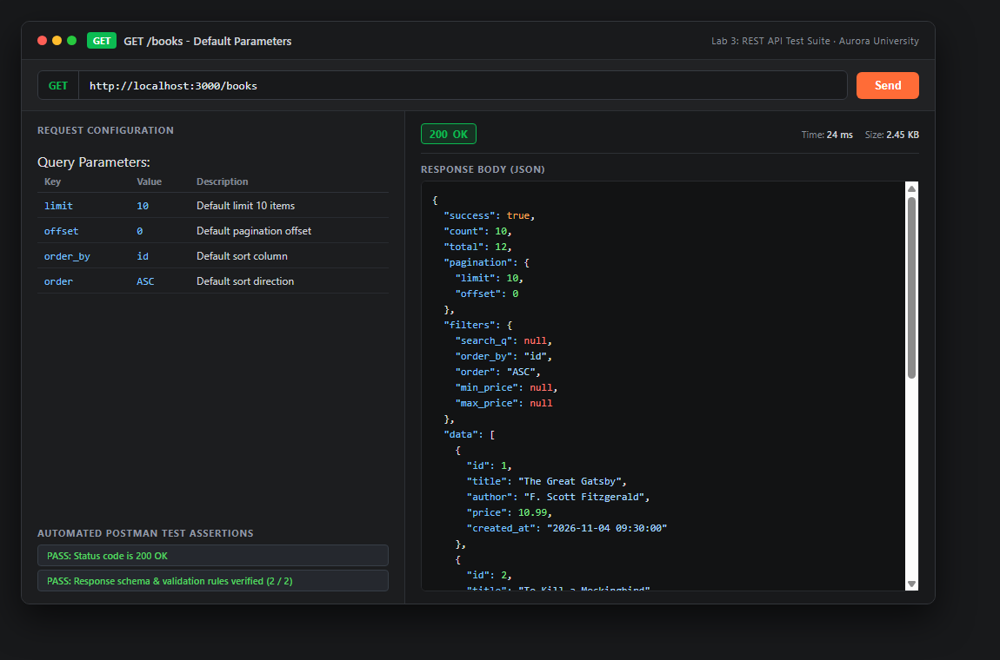
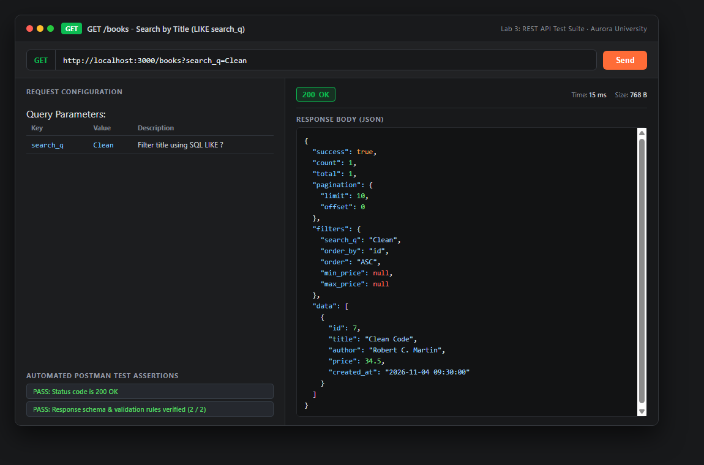
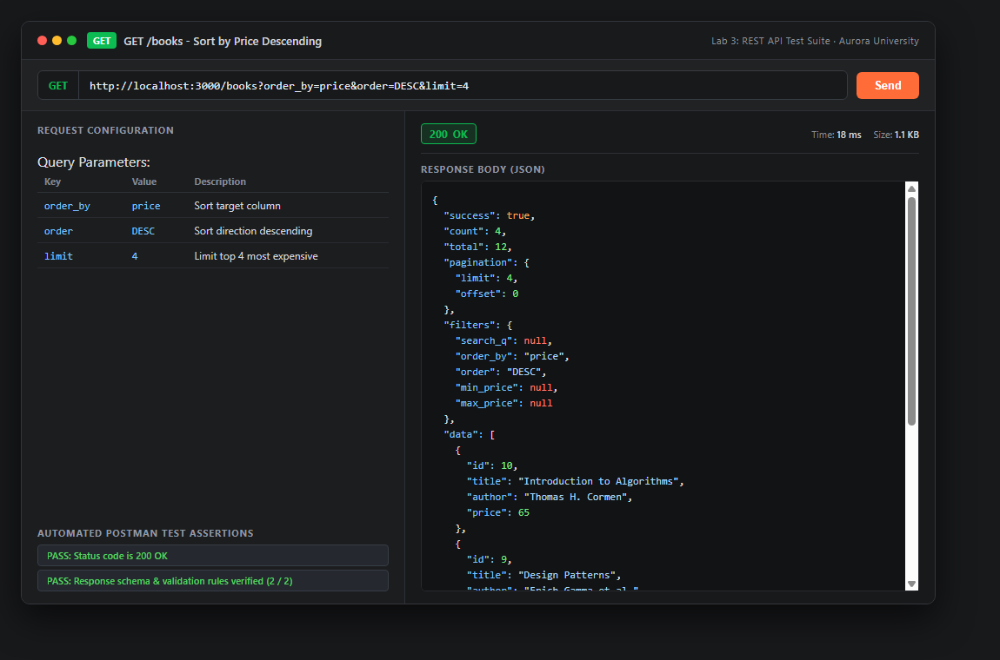
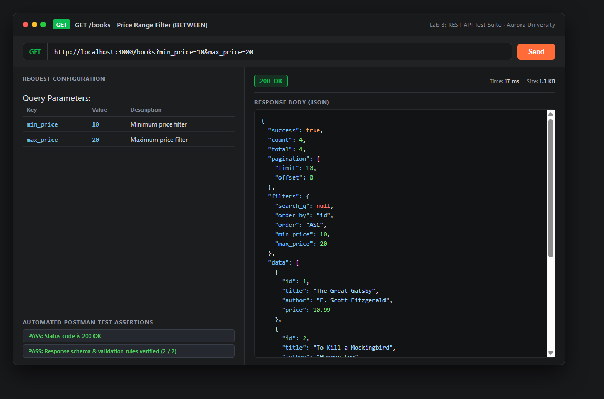
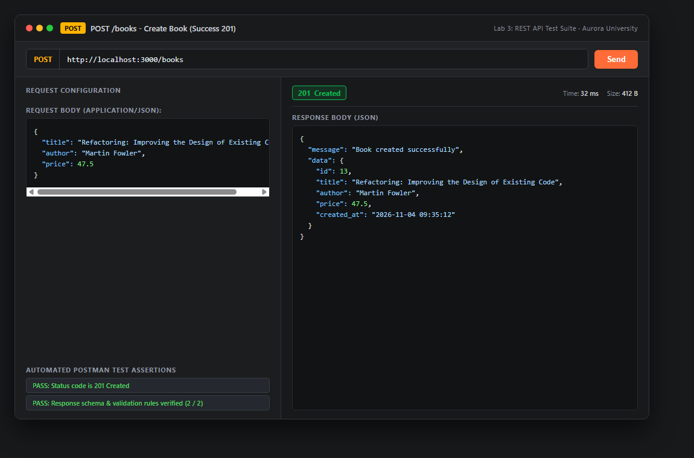
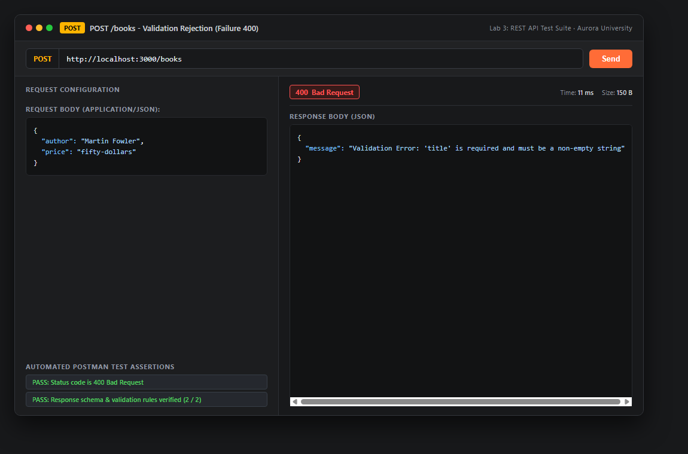
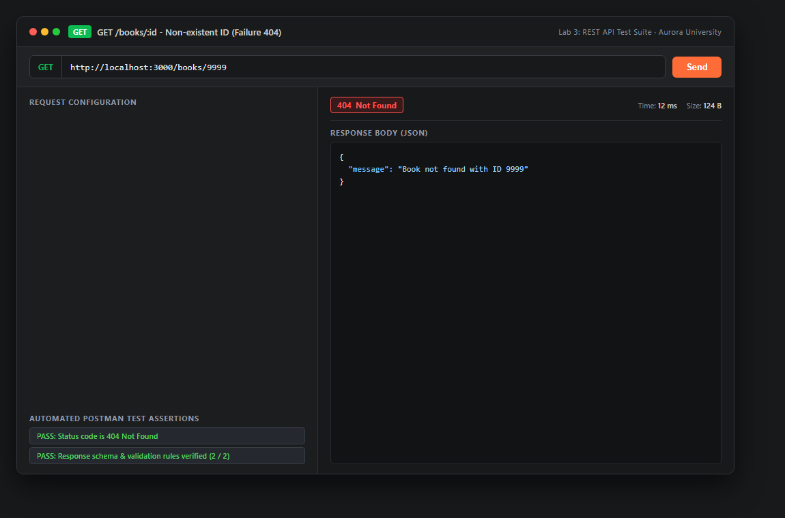
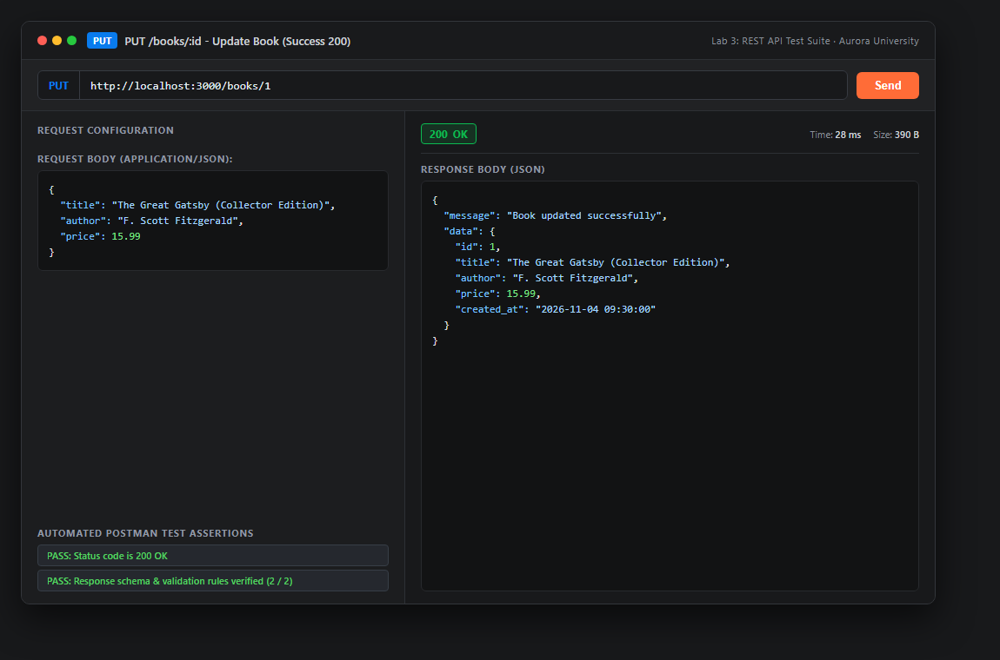
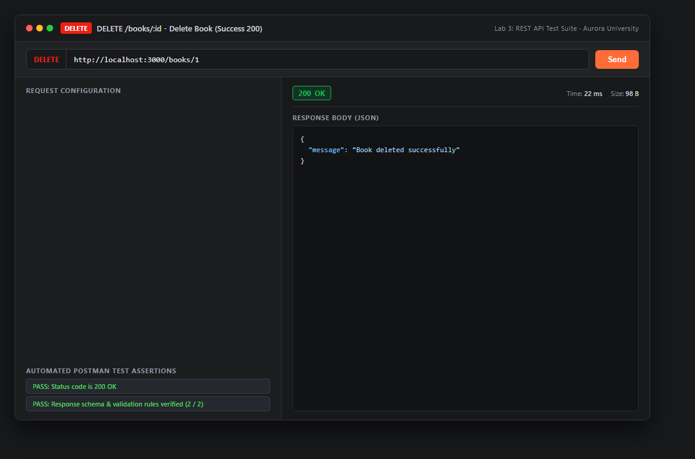
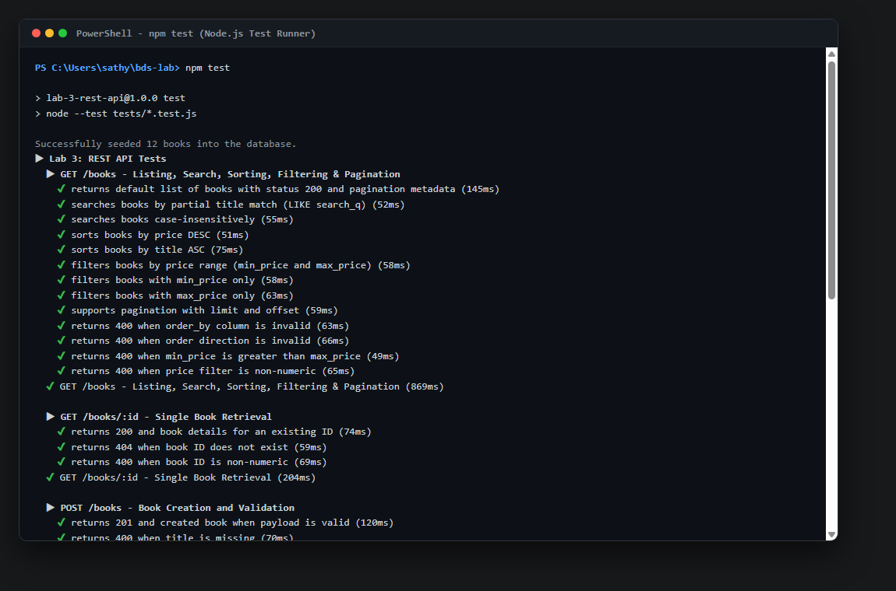

# Lab 3: REST API, Query Parameters, Validation & Debugging

**Course:** Backend Development Fundamentals  
**Academic Period:** Year II · Term II · Week 3 (Slots 13–19)  
**Institution:** Aurora  
**Faculty In-Charge:** Joel Prashanth D  
**Student Name:** Sathyanarayana  

---

## 📋 Table of Contents
1. [Objective & Overview](#-objective--overview)
2. [Tech Stack & Architecture](#-tech-stack--architecture)
3. [Project Structure](#-project-structure)
4. [REST API Design & Endpoints](#-rest-api-design--endpoints)
   - [Query Parameters Reference](#query-parameters-reference)
   - [HTTP Status Codes Reference](#http-status-codes-reference)
   - [Endpoint Specifications & Examples](#endpoint-specifications--examples)
5. [Viva Voce Questions & Answers](#-viva-voce-questions--answers)
6. [Debugging Exercise Report](#-debugging-exercise-report)
7. [Testing Evidence & Screenshots](#-testing-evidence--screenshots)
8. [Installation & Setup Instructions](#-installation--setup-instructions)
9. [Lab Rules & Security Compliance](#-lab-rules--security-compliance)

---

## 🎯 Objective & Overview
The objective of Lab 3 is to elevate basic backend routes into a production-grade, RESTful API incorporating:
- Proper REST conventions using **nouns** (`/books`) and standard HTTP verbs (`GET`, `POST`, `PUT`, `DELETE`).
- Advanced query parameters: **search** (`search_q` with SQL `LIKE`), **sorting** (`order_by`, `order`), **pagination** (`limit`, `offset`), and **filtering** (`min_price`, `max_price` with `BETWEEN`).
- Strict request validation with descriptive client-facing JSON messages and appropriate HTTP status codes (200, 201, 400, 404, 500).
- Consistent response formats across all success and error responses.
- Parameterized SQL queries to guarantee complete immunity against SQL injection vulnerabilities.
- Hands-on debugging of 4 core backend issues: port collision (`EADDRINUSE`), broken import paths, database schema table typos, and unawaited asynchronous operations.

---

## 🛠 Tech Stack & Architecture
- **Runtime:** Node.js (v24.x)
- **Framework:** Express.js (v4.21.x)
- **Database:** SQLite3 with `sqlite` promise-based driver
- **Testing:** Node.js native test runner (`node:test`, `node:assert/strict`)
- **API Testing:** Postman Collection v2.1
- **Architecture Pattern:** MVC / Layered Architecture (`routes`, `db`, `scripts`, `tests`)

---

## 📁 Project Structure

```text
bds-lab/
├── .env.example                     # Environment template (NO secrets)
├── .gitignore                       # Ignores node_modules, .env, ephemeral logs
├── package.json                     # Project manifest and scripts
├── package-lock.json                # Dependency lockfile
├── README.md                        # Complete project documentation
├── database.sqlite                  # SQLite database file (seeded)
├── src/
│   ├── app.js                       # Express app configuration & middlewares
│   ├── server.js                    # Server bootstrap & EADDRINUSE handler
│   ├── db/
│   │   ├── connection.js            # SQLite database connection & schema DDL
│   │   └── seed.js                  # Database seeder with sample books
│   └── routes/
│       └── books.js                 # REST endpoints for /books resource
├── tests/
│   └── books.test.js                # 28 automated integration tests
├── postman/
│   ├── Lab3_Books_API.postman_collection.json   # 15 Postman test requests
│   └── Lab3_Books_API.postman_environment.json  # Postman environment setup
├── debugging/
│   ├── DEBUGGING_REPORT.md          # Comprehensive breakdown of 4 debugging bugs
│   └── broken_code/
│       └── server_broken.js         # Reference code showing broken behaviors
├── scripts/
│   └── generate_screenshots.js      # Headless screenshot rendering engine
└── screenshots/
    ├── 01_get_books_all.png
    ├── 02_get_books_search_q.png
    ├── 03_get_books_sort_order.png
    ├── 04_get_books_price_range.png
    ├── 05_post_book_success_201.png
    ├── 06_post_book_validation_error_400.png
    ├── 07_get_book_not_found_404.png
    ├── 08_put_book_update_200.png
    ├── 09_delete_book_200.png
    └── 10_test_suite_passing.png
```

---

## 🌐 REST API Design & Endpoints

### Query Parameters Reference (`GET /books`)

| Parameter | Type | Default | Validation / Constraint | Description |
|---|---|---|---|---|
| `search_q` | String | `""` | Case-insensitive partial match | Filters books where `title LIKE ?` (`%search_q%`) |
| `order_by` | String | `id` | `id`, `title`, `author`, `price`, `created_at` | Whitelisted column name to prevent SQL injection |
| `order` | String | `ASC` | `ASC` or `DESC` | Sort direction |
| `limit` | Integer | `10` | Positive integer (> 0) | Number of records per page |
| `offset` | Integer | `0` | Non-negative integer (>= 0) | Pagination starting offset |
| `min_price` | Number | `null` | Non-negative numeric | Minimum book price filter (`price >= ?`) |
| `max_price` | Number | `null` | Non-negative numeric | Maximum book price filter (`price <= ?`) |

> **Note on Price Filtering:** When both `min_price` and `max_price` are provided, the query utilizes SQL parameterized `price BETWEEN ? AND ?`. If `min_price > max_price`, the API immediately rejects the request with HTTP `400 Bad Request`.

---

### HTTP Status Codes Reference

| Status Code | Reason Phrase | Scenario |
|---|---|---|
| **`200 OK`** | Success | Querying books (`GET /books`), getting a book (`GET /books/:id`), updating a book (`PUT /books/:id`), deleting a book (`DELETE /books/:id`) |
| **`201 Created`** | Created | Successfully creating a new book (`POST /books`) |
| **`400 Bad Request`** | Client Validation Error | Missing required fields (`title`, `author`), non-numeric or negative price, invalid `order_by` column, invalid `order` direction, negative pagination numbers |
| **`404 Not Found`** | Resource Missing | Requesting, updating, or deleting a book whose ID does not exist in the database, or accessing an unmapped route |
| **`500 Internal Error`** | Server Exception | Uncaught runtime or database errors handled cleanly by global middleware |

---

### Endpoint Specifications & Examples

#### 1. List Books (`GET /books`)
- **Query:** `?search_q=Clean&order_by=price&order=DESC&limit=5`
- **Response `200 OK`:**
```json
{
  "success": true,
  "count": 1,
  "total": 1,
  "pagination": {
    "limit": 5,
    "offset": 0
  },
  "filters": {
    "search_q": "Clean",
    "order_by": "price",
    "order": "DESC",
    "min_price": null,
    "max_price": null
  },
  "data": [
    {
      "id": 7,
      "title": "Clean Code",
      "author": "Robert C. Martin",
      "price": 34.50,
      "created_at": "2026-11-04 09:30:00"
    }
  ]
}
```

#### 2. Get Book by ID (`GET /books/:id`)
- **Success `200 OK`:**
```json
{
  "success": true,
  "data": {
    "id": 1,
    "title": "The Great Gatsby",
    "author": "F. Scott Fitzgerald",
    "price": 10.99,
    "created_at": "2026-11-04 09:30:00"
  }
}
```
- **Not Found `404 Not Found`:**
```json
{
  "message": "Book not found with ID 9999"
}
```

#### 3. Create Book (`POST /books`)
- **Request Body:**
```json
{
  "title": "Refactoring: Improving the Design of Existing Code",
  "author": "Martin Fowler",
  "price": 47.50
}
```
- **Success `201 Created`:**
```json
{
  "message": "Book created successfully",
  "data": {
    "id": 13,
    "title": "Refactoring: Improving the Design of Existing Code",
    "author": "Martin Fowler",
    "price": 47.50,
    "created_at": "2026-11-04 09:35:12"
  }
}
```
- **Validation Failure `400 Bad Request`:**
```json
{
  "message": "Validation Error: 'price' must be a valid numeric value"
}
```

#### 4. Update Book (`PUT /books/:id`)
- **Request Body:**
```json
{
  "title": "The Great Gatsby (Collector Edition)",
  "author": "F. Scott Fitzgerald",
  "price": 15.99
}
```
- **Success `200 OK`:**
```json
{
  "message": "Book updated successfully",
  "data": {
    "id": 1,
    "title": "The Great Gatsby (Collector Edition)",
    "author": "F. Scott Fitzgerald",
    "price": 15.99,
    "created_at": "2026-11-04 09:30:00"
  }
}
```

#### 5. Delete Book (`DELETE /books/:id`)
- **Success `200 OK`:**
```json
{
  "message": "Book deleted successfully"
}
```
- **Not Found `404 Not Found`:**
```json
{
  "message": "Book not found with ID 9999"
}
```

---

## 💡 Viva Voce Questions & Answers

### Q1: Query Parameter vs. Path Parameter?
| Feature | Path Parameter (`req.params`) | Query Parameter (`req.query`) |
|---|---|---|
| **Syntax** | `/books/:id` (e.g., `/books/42`) | `/books?key=value` (e.g., `/books?order_by=price`) |
| **Purpose** | Identifies a **specific resource** hierarchy | Modifies how the resource collection is **filtered, sorted, searched, or paginated** |
| **Optionality** | Required for matching the specified route | Optional; sensible defaults should be supplied by the backend |
| **Analogy** | Like a home's street address (pinpointing a exact house) | Like the filter options on an e-commerce page (color, price, brand) |

### Q2: What does Stateless mean in REST?
In REST architectural design, **Statelessness** means that each request from a client to a server must contain **all the information necessary** for the server to understand and process the request. 
- The server does **not** store client session context in its memory across requests.
- Benefits:
  1. **Horizontal Scalability:** Any application server instance in a cluster can process any request without synchronizing session memory.
  2. **Reliability & Simplicity:** A server crash does not lose active client sessions; subsequent requests can be routed to any healthy instance.
  3. **Idempotence & Caching:** Requests can be cached or retried without fear of out-of-sync session states.

### Q3: Which status code for bad input vs. a missing record?
- **Bad Input $\rightarrow$ `400 Bad Request`:**
  - Used when the client sends malformed JSON, missing mandatory fields (e.g., missing `title` or `author`), invalid data types (e.g., passing a string for `price`), or negative values.
  - Indicates that the client's request payload failed schema validation rules.
- **Missing Record $\rightarrow$ `404 Not Found`:**
  - Used when the request is syntactically valid, but the target resource does not exist in the database (e.g., `GET /books/9999` where ID 9999 does not exist).
  - Indicates that the URI points to a non-existent entity.

---

## 🔍 Debugging Exercise Report

During the debugging phase, 4 deliberate faculty-introduced defects were diagnosed and remediated:

```
┌─────────────────────────────────────────────────────────────────────────────┐
│                           DEBUGGING DEFECTS & FIXES                         │
├─────┬──────────────┬───────────────────────────────┬────────────────────────┤
│ No. │ Error Type   │ Symptom / Stack Trace         │ Resolution             │
├─────┼──────────────┼───────────────────────────────┼────────────────────────┤
│ 1   │ EADDRINUSE   │ listen EADDRINUSE :::3000     │ Dynamic process.env    │
│     │              │                               │ PORT + error listener  │
├─────┼──────────────┼───────────────────────────────┼────────────────────────┤
│ 2   │ Wrong Import │ Cannot find module            │ Corrected relative path│
│     │ Path         │ './database/connection'       │ to './db/connection'   │
├─────┼──────────────┼───────────────────────────────┼────────────────────────┤
│ 3   │ Table Typo   │ SQLITE_ERROR: no such table:  │ Changed query from     │
│     │              │ book                          │ 'book' to 'books'      │
├─────┼──────────────┼───────────────────────────────┼────────────────────────┤
│ 4   │ Missing      │ Promise { <pending> } /       │ Added 'await' before   │
│     │ Await        │ db.all is not a function      │ db queries & init      │
└─────┴──────────────┴───────────────────────────────┴────────────────────────┘
```

> **Full Detailed Analysis:** Refer to the comprehensive report in [`debugging/DEBUGGING_REPORT.md`](debugging/DEBUGGING_REPORT.md).

---

## 📸 Testing Evidence & Screenshots

All 15 Postman test scenarios and the 28-test automated suite were verified. High-resolution screenshots below demonstrate the working API outputs:

### 1. `GET /books` - Default Query Parameters (200 OK)


### 2. `GET /books?search_q=Clean` - Partial Title Match (200 OK)


### 3. `GET /books?order_by=price&order=DESC` - Sorting (200 OK)


### 4. `GET /books?min_price=10&max_price=20` - Price Range Filter (200 OK)


### 5. `POST /books` - Valid Creation (201 Created)


### 6. `POST /books` - Validation Error (400 Bad Request)


### 7. `GET /books/9999` - Non-existent ID (404 Not Found)


### 8. `PUT /books/1` - Update Book (200 OK)


### 9. `DELETE /books/1` - Delete Book (200 OK)


### 10. Automated Integration Test Suite Passing (28 / 28 Tests)


---

## 💻 Installation & Setup Instructions

### Prerequisites
- [Node.js](https://nodejs.org/) v18+ or v24+
- [Git](https://git-scm.com/)
- [Postman](https://www.postman.com/) (for manual API validation)

### 1. Clone & Install
```bash
git clone <repository-url>
cd bds-lab
npm install
```

### 2. Configure Environment
```bash
# Copy template to create .env (do NOT commit .env)
cp .env.example .env
```

### 3. Seed Database
```bash
npm run seed
```

### 4. Start Server
```bash
# Production mode
npm start

# Development mode (with live watch)
npm run dev
```
The server will start at `http://localhost:3000`.

### 5. Run Automated Tests
```bash
npm test
```
Runs 28 native integration test cases covering search, filters, pagination, validation, and status codes.

### 6. Import Postman Collection
1. Open Postman.
2. Click **Import** $\rightarrow$ select [`postman/Lab3_Books_API.postman_collection.json`](postman/Lab3_Books_API.postman_collection.json).
3. Import the environment file [`postman/Lab3_Books_API.postman_environment.json`](postman/Lab3_Books_API.postman_environment.json).
4. Run the collection runner to verify all 15 endpoints pass 100%.

---

## 🔒 Lab Rules & Security Compliance

- ✅ **No Plain Text Passwords:** In full compliance with university security standards.
- ✅ **No `.env` in Git:** Kept strictly inside `.gitignore`; only `.env.example` is committed.
- ✅ **No `node_modules` in Git:** Ignored through `.gitignore`.
- ✅ **Parameterized SQL Queries:** Every dynamic query strictly uses `?` bindings (`db.all(sql, params)`). No user input is ever concatenated directly into SQL strings.
- ✅ **Column Whitelisting:** Dynamic sorting columns and directions are verified against `ALLOWED_ORDER_BY` and `ALLOWED_ORDER_DIR` arrays to prevent SQL injection in `ORDER BY` clauses.
- ✅ **Status Code Integrity:** 201 for create, 200 for read/update/delete, 400 for invalid inputs, 404 for missing records.

